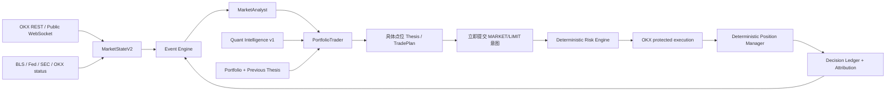

# COSMOS Trading Intelligence v2 架构

## 生产热路径

普通行情只更新 MarketState。普通持仓变化只进入确定性 Position Manager。只有无有效 Thesis、Wake/Entry 条件命中、计划到期或失效、交易结束、Thesis 失效、严格重大官方事件和有界 LLM 重试可调用 LLM。

## 状态与持久化

- MarketState、Thesis、Plan、WakeCondition、Position、DecisionEpisode 均版本化并带稳定哈希。
- 所有转换使用 SQLite 事务、乐观版本和幂等事件键。
- WakeCondition 在执行动作前按 Plan/WaitRuntime 实例原子 claim，跨重启不能重复触发，后继实例可安全复用条件标签。
- `EXTERNAL_EVENT` 仅允许已注册生产者；NO_TRADE 必须至少保留一个未来价格唤醒条件；硬阻断是可选信息，最长静默 60 分钟（WAIT 为 120 分钟）。不可达、已经满足、路径不存在、价格尺度错误或超时过长的非交易等待由确定性 Logic Gate 删除/补充 Regime fallback/截断期限，不改写方向、入场、止损、止盈、仓位或杠杆。
- 无 Thesis 时，Regime、结构突破以及带成交量确认的 5m/15m 波动扩张/ADX/EMA 边沿变化可持久化唤醒一次；普通 tick、持续为真的状态、已有 Plan 或持仓不会触发该兜底。
- 每个品种只允许一个 Active Thesis，有效活跃时间最多四小时；NO_TRADE 会撤销旧 Thesis，拒绝决策使用持久化有界重试与冷却而非随行情反复调用 LLM。
- DecisionEpisode 串联 MarketState、Delta、Analyst、Quant、Trader、Validator、Plan、Trigger、RiskAllocation、Orders、Position 和 Outcome。
- Prompt 版本、模型、Token、延迟、输入输出哈希、data_as_of 和证据引用全部入账。

## 决策边界

MarketAnalyst 无交易工具，也不承担审核职责。PortfolioTrader 是唯一策略决策者，返回方向、MARKET/LIMIT 订单意图、参考价或限价、止损、止盈和有效期。新交易意图在确定性风控通过后立即提交，不再挂载入场 WakeCondition；需要未来确认时返回 WAIT，由条件唤醒重新决策。健康行情不强制交易，没有机会可以 NO_TRADE。结构化契约只允许一次格式修复，仍失败记为 `DECISION_ERROR`。TradePlan 不包含数量、风险比例、杠杆或交易所请求。

Risk Engine 在触发后根据权益、止损距离、波动、流动性、相关性、敞口、日内损益和人工授权生成 RiskAllocation。初版 LLM confidence 不放大风险。

## 执行与恢复

- 生产首发范围为 OKX BTC/ETH/SOL USDT 永续。
- OKX_DEMO 复用原生 TP/SL、幂等 client ID、部分成交、私有流和 REST 对账。
- Position Manager 确定性处理止损、分批止盈、Break-even、ATR trailing、最长持仓、退出请求、保护覆盖和重启恢复；EXIT 通过幂等 reduce-only 订单收口。
- 订单状态不确定、保护缺失或对账失败时停止新增风险；历史订单与持仓证据不会被删除。
- Live 入场对账与持仓管理尚未完成，当前执行边界无条件拒绝 LIVE_AUTHORIZED；授权预览给出阻断原因，历史授权不能绕过。
- HALT/停止自动化使旧决策代次失效；每个交易所子订单在提交边界重新检查。HALT 返回前等待已进入提交阶段的请求结束，已发出的订单仍需成交/撤单对账。
- 账户、凭证和连接设置更新与入场串行；自动化开启或仍有持仓/活跃入场时不允许切换。Demo 管理客户端在配置代次变化后重建。
- 管理 API 面向仅监听回环地址的单用户工作台，无登录密钥、Cookie 会话或 Bearer 认证；HTTP 校验 Host、Origin 和 Fetch Metadata，WebSocket 校验 Origin。行情原始写入 HTTP 接口关闭，生产者写入及执行检查均限制未来时间偏差。

## 官方事件

OfficialEventClient 独立采集 BLS CPI/NFP、Federal Reserve FOMC、SEC 新闻与 OKX 系统状态。每个源独立健康降级；一个源失败不能清空其他源结果。ETF Flow 在没有可靠官方免费实时源时固定为 `unavailable`。外部文本先规范化，再进入 MarketState 和 LLM 上下文。

## Quant Intelligence

Quant v1 只训练 BTC/ETH/SOL 5m，使用 2 ATR 目标、1 ATR 止损、24 根超时的 Triple Barrier。推理在 5m 收盘执行，TTL 10 分钟。模型只有在 purged OOF Brier 与 log-loss 均优于三分类均匀基线时才标记健康。Live 的 LONG/SHORT 必须使用健康模型且方向一致、成本后期望为正；Demo/Shadow 保留 Quant 作为反事实证据，不让 Quant 创建计划、订单或仓位。

## 离线 Research

Strategy DSL、Campaign、PBO、CPCV、Walk-forward、Shadow、Champion、密封盲集和模型训练均属于离线 Research。研究结果保存为候选、模型和证据，但没有自动交接实时执行的入口。

## 已移除的架构

旧 `AgentGoal + poll_seconds` 调度、`SCHEDULE_TRIGGERED`、旧 WAIT 终止语义、`screen_trade_candidates → backtest → execute`、旧 Agent WebSocket/API 和旧 Live 授权已从生产源码与路由表移除。历史 `trade_episodes` 仅通过只读模型用于证书与审计解析。

`/api/dashboard` 现在只是行情、K 线、账户、订单和全局风险状态的只读聚合，不再隐式生成 `StrategyPlan`、运行 Strategy DSL 或执行回测；`/api/risk` 也不会创建计划。策略生成与回测仅能从离线 Research 接口显式发起。

当前接口以 `/api/trading-intelligence/*` 为唯一实时交易命名空间。旧路径不注册，因此返回 404；迁移计数可通过 `/api/trading-intelligence/migration-summary` 查看。

## 应用依赖与领域边界（2026-10-31）

`api.create_app()` 只装配路由、中间件和静态资源；默认 ASGI 对象导入时不会创建数据库、读取凭证或计算 Git 身份。生产 lifespan 创建 `ApplicationServices`，测试通过 `create_app(services=...)` 显式注入隔离依赖。

- `routes_*` 是薄 HTTP/WebSocket 包装，保持原 URL、方法、数据契约与操作 ID。
- `service_*` 按实时决策、执行、查询、后台生命周期、配置、行情及离线研究领域组织。领域服务共同组成应用服务门面，状态和可替换的交易所／模型／研究依赖属于实例，不属于模块全局变量。
- `api_contracts` 保存请求与响应类型；底层服务与仓库不导入 HTTP 入口。
- `SqliteStore` 是共享 WAL、连接、锁和事务所有者，方法显式委托到 `repository_*`。仓库共享同一所有者，不为一次原子操作创建独立事务。
- 每账户仍只支持一个执行服务进程，不能通过增加 Uvicorn workers 扩容交易执行。多个测试应用使用不同数据目录、锁、缓存与队列。

## 学习与隔离对照

经验每 30 秒在后台从完整归因更新，保留组合去重、模式隔离和首次可用时间；决策按开始时间筛选案例。历史版本缺少时间证据时仅展示，不用于无泄漏案例检索。每次决策绑定学习版本、案例 ID 和输入哈希。

在线对照复用原 Analyst 与 Trader 输入，只移除学习上下文；主调用记录厂商配置哈希，对照前检查相同厂商配置与模型，变化则跳过成功对照。对照 HTTP 请求不自动重试、不切换厂商；最多一轮格式修复。10% 稳定抽样、上海日期每天 10 组、单并发、队列 10 组、60 秒超时，全部额度与状态落库。重启将未完成请求标记中断，不重新调用付费接口。

影子队列只依赖学习仓库与模型网关，不持有执行入口；结果不写入订单、计划、持仓或成交经验库。后续 24 根完整 5m K 线计算方向收益、MFE、MAE，仅是价格代理指标，非成交盈亏。少于 30 组显示样本不足，超过阈值仍只是观察性证据，不自动晋升策略。
