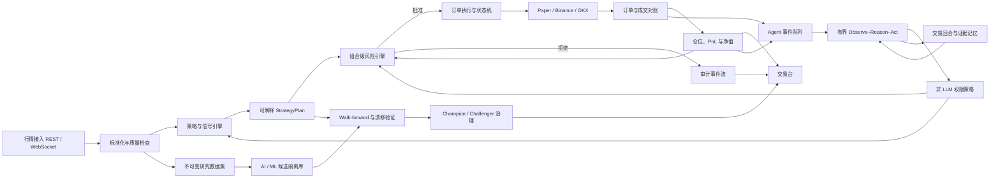

# COSMOS Quant 架构设计

## 设计原则

1. **解释与执行同源**：自然语言不是模型输出后的装饰。`StrategyPlan` 是执行引擎唯一接受的协议，页面文字由同一份结构化数据渲染。
2. **风险先于信号**：策略只产生订单意图，只有风险引擎能把意图提升为可执行订单。
3. **实盘默认关闭**：模拟盘、交易所测试网、实盘是三个隔离环境。切换环境不复用状态或凭证。
4. **可重放**：行情快照、策略版本、风控结果、订单状态迁移均进入审计事件流。
5. **Decimal 贯穿资金链路**：价格、数量和费用不使用二进制浮点数做最终账务计算。

## 逻辑组件

## Agent 控制层

Agent 是既有量化平台之上的持久化控制层，不替换策略、回测、风险或执行引擎。`AgentGoal` 定义持续目标，市场/订单/仓位事件以语义幂等键进入队列；`AgentRun` 持有最多 8 步的状态，模型每一步只能返回结构化 `AgentDecision` 和一个注册工具调用。事件租约、运行状态、观察结果和工具幂等结果均写入 SQLite，因此进程中断后可以恢复，且不会因为模型重试重复下单。

`AgentPolicy` 是模型之外的授权边界。它把自主级别、品种/周期白名单、单笔风险、日内回撤、每日交易次数、持仓数量和杠杆上限固化为指纹。增仓前先以 SQLite 事务预留交易预算，再读取最新账户状态并经过平台硬风控；任何权限变化、目标暂停、环境切换、对账不确定或全局停机都会使执行 fail closed。模型不能修改权限，也不能恢复全局风险闸。

平仓后，系统从 Paper 或交易所私有成交历史中按订单 ID / 高熵客户端标签归因入场和保护单退出，计算费用后净 PnL 与风险收益倍数，并写入带订单证据引用的 Episode 记忆。没有完整成交证据时不生成收益记忆。

## 策略协议

`StrategyPlan` 包含：

- 交易所、品种、周期、方向、版本
- 市场类型、全仓/逐仓保证金模式与执行杠杆
- 入场类型、触发价、允许滑点、有效时间
- 一个硬止损与一个或多个止盈目标
- 按账户风险预算计算的建议数量
- 最低盈亏比、策略失效条件与暂停条件
- 面向人的摘要和逐条依据
- 生成时行情快照与确定性指纹

非纸面合约策略的定仓权益只能来自交易所账户，浏览器传入的模拟权益会被忽略。风险引擎同时检查名义敞口、`名义价值 / 执行杠杆` 所需保证金、交易所可用保证金、止损距离与保守清算缓冲；计划杠杆、保证金模式和当前运行配置任一不一致都会拒绝激活及执行。

因此“BTC 到 61,240–61,360 USDT 做多，跌破 59,980 止损，在 63,880 / 65,420 分批止盈”既能显示给操作者，也能被回测和执行引擎无歧义消费。

## 信号、市场状态与研究治理

策略研究层的生产决策是确定性量化逻辑，不调用大模型决定方向或价格。默认市场状态引擎分别计算趋势、均值回归和突破评分，再让三类策略的可执行信号按“信号置信度 + 市场状态得分”竞争；没有合格信号时保持 `FLAT`。操作者也可以关闭自动选择并固定策略家族。自然语言描述只进入版本说明和交易论点，不会绕过参数边界或直接控制订单。

`StrategySpec` 对 EMA 周期、RSI、z-score、成交量、ATR 止损和目标参数执行类型、范围与交叉字段校验，并生成稳定指纹。AI/ML 来源只能写入研究候选库；即使构造出带 `source=ai/ml` 的计划，风险引擎仍会以 `research_source_isolated` 拒绝执行。候选必须绑定不可变数据集、通过相同 Walk-forward 门槛和漂移检查，再由明确确认短语晋升为研究 Champion；Champion 不会自动替换已审核的交易计划。

每个策略家族都允许返回 `FLAT`。系统只使用已收盘 K 线计算信号，并用更高周期 EMA 做方向确认；研究模式样本不足时降低置信度并披露，测试网/实盘生产模式则直接 `FLAT`。计划激活和订单提交前都会重新计算最新信号，方向不一致或已经变为 `FLAT` 时 fail closed。

研究历史与图表展示相互独立：图表固定返回最近 300 根，研究层默认加载 2,000 根并支持配置到 50,000 根。CCXT 适配器使用 `since` 分页拉取并与 SQLite 历史去重合并，后续刷新只补最近窗口；数据复用身份包含交易所、市场类型、币种与周期，现货请求不能复用同名永续数据。

回测采用逐根 walk-forward，信号 K 线不能在同一根成交，入场计划八根 K 线后失效，同根同时触及止盈和止损时按止损优先。年化因子随周期变化；报告拆分手续费、滑点、历史资金费、敞口、样本年数、期望值、Calmar 和年化收益。交易所可提供历史资金费时按持仓方向、结算时点和剩余数量计入；历史持仓量只在该信号时点已经发布且不陈旧时用于 24 小时变化过滤。任一数据不可用时明确标记并失败关闭，不使用当前值伪造历史。默认审核门槛要求至少 1,000 根样本、100 笔交易、Profit Factor 不低于 1.15、最大回撤不高于 20%，且在 1.5 倍手续费和 2 倍滑点压力下收益仍为正；未通过的版本不能审核和激活。

研究数据集 schema v3 将交易所、市场类型、品种、周期、完整 K 线、资金费点和持仓量点共同哈希并只写一次，同时记录每种衍生品数据的真实时间覆盖率。研究抓取可使用独立于交易账户的 OKX/Binance/Bybit 只读公共适配器，因此跨交易所证据不会修改当前下单场所或凭证。所有回测产物记录 `dataset_id`、数据指纹、策略指纹和时间范围。单策略长回测和完整 Campaign 都进入有界并发的持久化任务队列；Campaign 逐单元缓存、报告进度并可在进程重启后恢复。

官方历史目录证据使用精确域名和路径白名单在服务端抓取，原始响应先做 SHA-256 再规范化，
并拒绝分页未完成、空目录、范围错位和非官方跳转。Binance 月度 K 线锚点扫描会对完整候选集
逐一验证官方 ZIP、配套 CHECKSUM、唯一 CSV、时间范围和 K 线顺序；404 只能证明该归档月未观察
到文件，不能被解释为当时未上市或已退市。因此官方归档存在性和历史点时上市状态是两个独立
证据层，前者不能自动解除生存偏差门槛。

单腿 Campaign 同时维护两种身份：证据谱系绑定不可变源数据和一次性盲集；永久试验家族
绑定研究域与市场类型。前者阻止同源重切分或重复开启盲集，后者保证重新下载、换交易所、
换币种或换周期不能清零累计假设和顺序试验惩罚。失败 Campaign 最多冻结一次 1–3 个
单变量子假设；唯一后继必须保留全部父假设并复用完全相同的证据范围，禁止第二后继与
孙代。重复请求由实验指纹返回同一 Campaign，并逐单元命中缓存。

双腿相对价值研究使用两个已验证不可变数据集的同步时间戳，滚动对数价差只能读取当时信息，信号后下一根同时模拟等美元多空，逐腿计费、计滑点和资金费，并用逐 K 线盯市权益计算回撤与 Sharpe。均值回归模型还要用形成期执行不伪造 p 值的 Dickey–Fuller 临界值、AR(1) 半衰期和形成期内部结构检查；交易期只用于样本外绩效与均值/方差突变裁决，不能反向参与参数估计。

期现 Carry 研究要求同一交易所、同一规范币种与同一周期的独立现货和永续数据集。信号使用收盘后的基差及截至当时已公布的资金费，双腿在下一根同步开盘成交；回测按真实资金费时间点、双腿手续费/滑点、资金占用成本和期末强平计算。Carry Campaign 跨至少 3 个币种和 2 家交易所执行时间折、FDR 与 PBO，但当前没有原子双腿执行证书，因此其结果只能拒绝或保留研究，不能进入单腿执行层。

## 个人生产运行边界

当前版本采用本机单进程部署：FastAPI 同时托管 Web UI，SQLite WAL 保存配置、策略、行情缓存、订单账本、风险状态与审计，密钥由操作系统凭证库管理。单进程减少了个人运行时的部署和网络边界，但仍把行情、策略、风险、执行、对账划分为独立模块。

已经落地的生产保护包括：

- 公共行情 REST/WS 双通道、交易所原生多周期 OHLCV、浏览器实时推送、质量检查和仅可信缓存降级
- 策略/回测数据指纹、版本审核与自动执行调度
- 交易所原生原子保护单；保护能力未验证时 fail closed
- 测试网保护单 commissioning：最小远价单实际提交、保护关系回查、撤单确认与凭证指纹绑定
- 操作系统凭证库按 `exchange:mode` 隔离；旧版 exchange-only 凭证只迁移到一个明确模式
- 策略协议绑定交易所、模式和市场；执行环境变化时归档活动策略，跨环境订单意图硬拒绝
- 合约策略额外绑定保证金模式和杠杆；OKX 下单前同步杠杆，合约张数在适配层与基础币数量双向换算
- 适配层将策略规范符号解析为 CCXT 的 USDT 结算永续符号；行情、资金费率、杠杆、精度与下单共用同一市场身份
- 实时资金费率进入预交易风控；交易所模式拿不到费率或费率绝对值越界时拒绝新开仓；历史回测使用交易所历史费率并与数据集共同固化
- 组合风险预算估算存量仓位压力损失，并限制跨品种同向敞口；新计划先缩仓，执行前再次硬检查
- 单向持仓模式禁止带着反向仓位直接开仓，避免反向单先减仓后裸露未受预期保护的新方向
- 非纸面环境有挂单或持仓时禁止切换交易所、模式或市场，避免遗留无人管理的风险敞口
- 每笔正式订单提交后再次回查保护关系；缺保护或无法确认时尝试撤单、写入不安全账本并停机
- 私有订单回报、10 秒 REST 对账、重启恢复与不确定状态熔断
- 每日权益基线、手动停机、日内回撤锁定和订单到期撤销
- Prometheus 指标、就绪检查、SQLite 在线备份与 `quick_check`

无法由代码仓库替代的上线验收：

- 使用操作者自己的测试网 API 完成认证、下单、部分成交和撤单演练
- 验证本机时钟同步、出口 IP 白名单和交易所限频表现
- 连续数周影子盘/测试网运行，并检查每日对账和备份
- 实盘前确认账户模式、杠杆、逐仓/全仓、最小下单量和手续费等级

Binance USDT 永续在其 2026 Algo Order API 迁移完成验证前保持硬禁用；这条限制不能通过关闭风控绕过。
