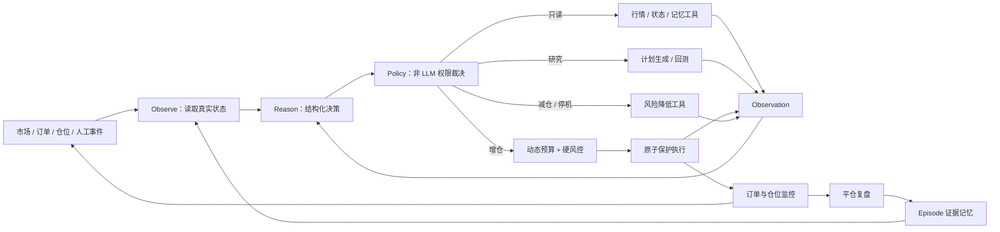

# COSMOS 交易 Agent

## 定义

COSMOS 的交易 Agent 是一个持久化、有目标、能感知事件、能调用受限工具、能执行行动并从结果中形成证据记忆的控制循环。它不是把聊天模型直接接到交易所 API，也不是给传统自动策略换一个 Agent 名字。

## 图片中十项能力的对应关系

| 要求 | COSMOS 实现 |
|---|---|
| 自动感知市场变化 | 定时事件、行情上下文、市场状态分析；订单和仓位事件进入同一队列 |
| 判断当前市场状态 | 确定性趋势/震荡/突破分析工具，AI 只能引用其结果 |
| 决定是否采取行动 | `AgentDecision` 强类型协议；证据不足时 `WAIT` |
| 自主选择并调用工具 | 工具注册表、机器可读 JSON 参数 Schema、动作→工具白名单 + 最多 8 步的 Observe–Reason–Act 循环 |
| 生成结构化交易计划 | 唯一执行协议 `StrategyPlan`，并绑定目标、运行和权限指纹 |
| 调用回测和风险引擎验证 | 计划必须绑定最新回测且通过稳健性门槛；激活和执行前再做实时硬风控 |
| 决定执行、拒绝或等待 | 入场、撤单、减仓、退出、停机和等待均为枚举动作；权限门独立于模型 |
| 监控持仓和风险 | 持久化订单账本、私有回报/REST 对账、仓位事件和全局停机 |
| 平仓后复盘 | 使用账户私有成交记录归因价格、数量、费用、PnL 和 R 倍数 |
| 结果写入记忆 | `AgentMemory` 记录交易回合、置信度和订单证据，后续运行可检索 |

## 权限和执行边界

- `observe`：只读行情、账户、订单和记忆。
- `research`：可以建立研究计划和回测，不能增加账户风险。
- `paper`：允许在本地持久化 Paper 账户中受限自主交易。
- `sandbox`：只有平台当前处于交易所测试网、连接与原子保护验收通过时可用。
- `live_capped`：要求平台已显式解锁实盘，并继续受更严格的 Agent 子预算约束。

每个增仓调用必须声明品种、周期、风险比例、杠杆和原生保护；策略生成后绑定权限指纹，任何授权修改都会使旧计划失效。每类动作只能调用显式白名单中的工具，未知的增仓、减仓或控制工具默认拒绝。工具调用有幂等键，结果和 Observation 在同一 SQLite 事务中落盘。

减仓/平仓会在调用交易所前先持久化 client order ID。调用超时、进程中断或回执不确定时不会盲目重试，而是将交易回合标为 `UNCERTAIN` 并停机；后台使用订单 ID、持久化 client order ID、私有成交和账户仓位重新归因，再核验剩余原生保护数量。

## 策略研究闭环

研究 Agent 的权威流程是：

1. `analyze_market_state` 感知当前结构并取得非冗余指标建议；
2. 从 94 个单腿公开模板、46 个单腿原型、6 个配对模板和 2 个期现 Carry 模板中按市场适配与所需数据排序，或登记 AI/ML 受约束候选；
3. `prepare_research_universe` 优先使用 `selection_mode=point_in_time`，在抓取 K 线前先固化
   OKX/Binance/Bybit 完整市场目录、上市时间、活跃状态、流动性排名、入选与排除原因，
   同时冻结每周期所需 K 线数量和最低覆盖率，再抓取“交易所 × 品种 × 周期”OHLCV、
   资金费和持仓量历史数据；任何市场覆盖不足都会使完整物化失败，不能静默删掉该市场；
   当前目录不能倒推出已退市历史，因此历史幸存者覆盖必须明确保持“未证明”；后台从
   当前时点持续保存 Binance/OKX 现货和永续完整结构目录，以父链哈希记录新增、下线和
   修改，但有界轮询不会被误报成官方无缺口历史事件归档；
4. `run_research_campaign` 绑定 `universe_snapshot_id` 并要求数据集完整覆盖冻结市场，运行
   完整策略 × 数据集矩阵，记录所有试验并计算跨市场、Deflated Sharpe/FDR、Monte
   Carlo 与 PBO；事后删掉不利币种会被拒绝；未显式指定策略时，Agent 只能依据开发集
   的因果特征可用性预筛出至少覆盖 3 币种 × 2 交易所的公开先验，预筛不读取收益、
   交易结果或盲集，因此不会把缺数据造成的零单元误当成策略竞争，也不会窥视盲测；
5. `revise_failed_strategy` 只根据明确失败归因产生单一修改假设，子策略必须重新验证；
6. `review_strategy_health` 根据独立失败证据降级或退休 Champion；
7. 相对价值 Campaign 默认将前 25% 同步数据冻结为形成期；均值回归模型只能用形成期
   估计对冲关系和 Dickey–Fuller/半衰期证据，再以隔离交易期检查均值/方差结构突变；
8. `run_carry_campaign` 只接受同交易所、同币种、同周期的现货+永续精确双腿，并要求
   每家至少 3 个币种、至少 2 家交易所；只使用已公布资金费和真实历史结算现金流；
9. Carry 若在完整样本中没有确认后机会，只能要求新的独立市场/时间数据，禁止事后降低
   基差或资金费阈值；已有交易但质量失败时最多冻结 3 个不放松准入的单变量子假设，且
   只允许一个后继 Campaign；
10. 配对和 Carry 只允许开发集冻结的唯一候选原子消费一次密封盲集，盲测明细不进入 Agent 上下文且开封后谱系永久封存；开发、PBO 和盲测全部 PASS 后才能签发绑定冻结策略规格、周期与精确两腿范围的 v2 证书；Paper 与 Sandbox 多腿协调器已实现回执恢复、单腿补偿、协调平仓和重启续跑，Sandbox 必须先通过同凭证同范围 commissioning；持仓后按回测同源的因果价差/基差规则自动退出，Live 在没有盈利 Champion 时保持硬锁；
11. 只有 Campaign 与当前策略/数据指纹完全匹配时，
   `execute_validated_trade_plan` 才能进入最新信号、组合风险和原子执行。

Campaign 不使用额外市场家族过滤替策略隐藏不利行情；市场状态只负责实时选择已验证
策略。`live_capped` 模式还要求 Campaign 的 PBO 与跨市场门槛同时通过。当前真实
Campaign 没有产生合格策略，因此正式执行保持 `HOLD`。

Campaign 作为持久化后台作业运行，逐单元保存进度，并使用“策略指纹 × 数据指纹 ×
试验总数 × 研究配置 × 引擎版本”缓存。进程重启后会恢复未完成作业；PBO 在组合
切分过大时使用固定种子抽样，并以 95% 置信上界而不是点估计作通过判断。

## 当前验收边界

自动入场、原生止盈止损、订单恢复、仓位关闭事件和私有成交复盘已经接入统一闭环。Paper 支持 Agent 主动减仓/清仓并同步调整模拟保护数量。OKX 永续主动减仓/清仓会在 reduce-only 成交后同步缩量或撤销附加 Algo 保护单，并重新查询保护单最终状态与账户仓位；任一环节不确定都会将交易回合标为 `UNCERTAIN`、停止新开仓，并由后台继续核验，但不会自动解除全局停机。

交易所仓位管理仍有独立的运行许可：操作者必须先在设置页完成普通原子保护单验收，再明确触发一次 OKX Demo 的真实成交、部分减仓、保护重整、最终平仓和空仓回查。该验收结果与交易所、市场和凭证绑定；未通过时 Agent 的交易所开仓、主动减仓和平仓工具全部硬拒绝，避免建立一个 Agent 无法安全管理的仓位。Paper 不受此限制。

`GET /api/agent/readiness` 是自主交易的统一就绪度裁决。它逐项报告 AI 推理服务、执行网关、仓位管理验收、全局风险闸、自动入场授权、活动目标和不确定交易回合对账；只有全部通过才返回 `ready_for_autonomous_trading=true`。该状态也显示在交易 Agent 页面，并用于锁住交易目标的手动运行入口，但真正的安全边界仍在后端工具和执行层。

代码测试只能证明协议和故障路径，不能替代操作者账户上的测试网认证、成交、部分成交、保护单触发、断网恢复和限频验收。
